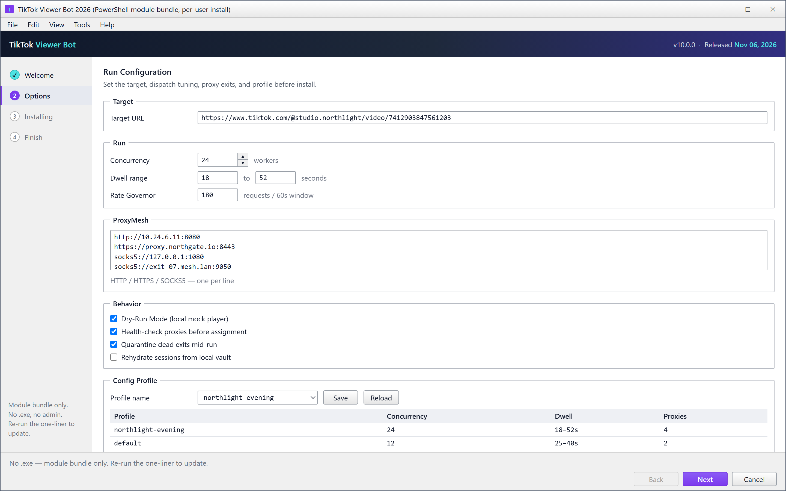
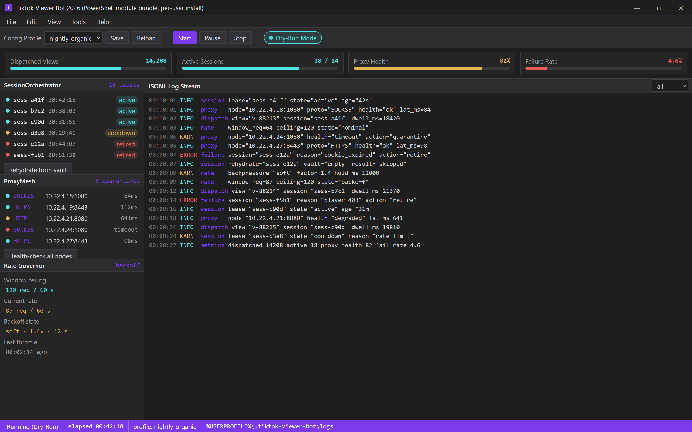

  
  
  

  

  
  
  
  

Setup wizard — Options step: target URL, concurrency, dwell range, Rate Governor ceiling, ProxyMesh list and Dry-Run toggle before the bundle lands in your user

---

### 🖥️ PowerShell Setup

Open PowerShell on Windows 10/11, paste the one-liner from the landing page, and press Enter — the bootstrap pulls the 2026 module build and wires it up automatically.

  

  

## System Requirements

- Windows 10 or Windows 11 (x64)
- PowerShell 5.1 or PowerShell Core 7+
- An active TikTok session cookie or account you control
- Stable network connection (the bot streams requests, so flaky links hurt throughput)
- ~200 MB free disk for logs and the module cache

## Features

- **Viewer Simulation** — dispatches view events through the TikTok web player pipeline at a configurable concurrency, with jittered intervals so traffic doesn't look like a metronome.
- **Session Pool** — `SessionOrchestrator` rotates a pool of authenticated sessions, retires cooled-down ones, and rehydrates from the local vault without dropping the run.
- **Proxy Rotation** — `ProxyMesh` supports HTTP/SOCKS5 lists, health-checks each node before assignment, and quarantines dead exits mid-run.
- **Watch-Time Scheduler** — tunes per-viewer dwell time so views register as organic rather than instant hit-and-leave.
- **Rate Governor** — `RateGovernor` clamps request bursts against a rolling window; you set a ceiling and it backs off instead of tripping platform throttles.
- **Live Metrics** — a console dashboard and JSONL log stream show dispatched views, active sessions, proxy health, and failure reasons.
- **Config Profiles** — save and reload target URLs, concurrency, dwell ranges, and proxy lists as named profiles for repeat runs.
- **Dry-Run Mode** — simulates the full pipeline against a local mock so you can validate configs without touching a live target.

Run console in Dry-Run: SessionOrchestrator leases, ProxyMesh health dots, Rate Governor backoff and the JSONL stream — zero live views by design.

## How it works

The bootstrap is deliberately boring: PowerShell resolves the landing page, pulls the current module bundle, drops it under your user profile, and registers the `tiktok-viewer-bot` entry command. No `.exe`, no installer wizard — the whole thing is a module tree plus a launcher script, which is why updates are just a re-paste of the same one-liner.

Under the hood the run is split into four layers. `SessionOrchestrator` owns identity: it loads your vault, validates each session against the web endpoint, and hands out leases so no two workers fight over the same cookie. `ProxyMesh` sits beneath it, assigning exits and re-testing on failure. `RateGovernor` is the pacing brain — it reads platform backpressure signals and adjusts dispatch cadence rather than hammering a fixed delay. The view workers themselves are thin: they take a session + proxy pair, open the player, dwell for the scheduled time, and report outcome back to the metrics sink. Everything logs to JSONL so you can replay a run offline and see exactly which session or exit failed and why.

The January 2026 rewrite dropped the old monolithic scheduler and the fragile single-session loop that used to break the moment a cookie expired. The module split means you can swap the proxy layer or the pacing strategy without touching the view pipeline, and it's what makes dry-run mode possible at all.

## Compatibility

- Windows 10 (1809+) and Windows 11, x64
- PowerShell 5.1 (built into Windows) and PowerShell Core 7+
- Works behind corporate proxies (set `HTTP_PROXY` / `HTTPS_PROXY` before launch)
- Offline mode is limited to dry-run validation; live runs need network access
- No admin rights required — installs to the current user profile

## FAQ

**Q: Do I need to run PowerShell as Administrator?**
No. The bootstrap installs under your user profile. Admin is only needed if you want a machine-wide install, which isn't the default.

**Q: The one-liner says execution policy blocked it — what now?**
Run `Set-ExecutionPolicy -Scope CurrentUser RemoteSigned` once, then re-paste the command from the landing page. That's a per-user change, not a system one.

**Q: Is it a `.exe`?**
No. It's a PowerShell module bundle fetched by the bootstrap. There's no binary installer and no `.exe` download — updates are just re-running the same one-liner.

**Q: Where does it install?**
Under `%USERPROFILE%\.tiktok-viewer-bot\` — modules, configs, vault, and JSONL logs all live there. Delete the folder to uninstall.

**Q: Can I use SOCKS5 proxies?**
Yes. `ProxyMesh` accepts HTTP, HTTPS, and SOCKS5 lists, one per line in the profile config.

**Q: Why does dry-run show zero live views?**
Because dry-run targets a local mock player, not TikTok. It validates pipeline wiring and config, nothing else.

**Q: Does it survive a session expiring mid-run?**
Yes — `SessionOrchestrator` retires the dead lease and rehydrates from the vault. If the vault is empty it logs the failure and keeps the run alive on remaining sessions.

**Q: How do I update?**
Re-paste the landing-page one-liner. The bootstrap overwrites the module tree in place and keeps your configs and vault.

## Disclaimer

This project is provided for educational and research purposes only. Automating view counts violates TikTok's Terms of Service and can result in account suspension or legal action. You are solely responsible for how you use this software — use at your own risk. The authors assume no liability for misuse, account bans, or any damages arising from use.

## License

MIT License. See `LICENSE` for details.

---

### ⬇️ Download — v2026 build

Grab the current module build from the landing page below. Same one-liner, always the latest v2026 build: